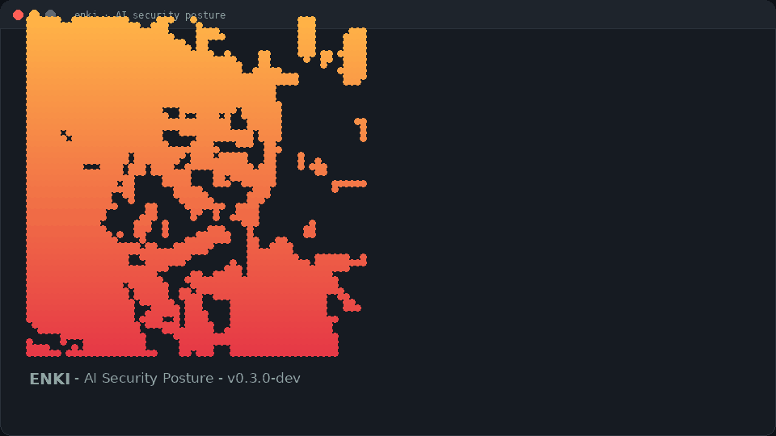

# enki — AI Security Posture CLI

enki is a single-binary, cross-platform security scanner focused on the **AI
stack** on developer laptops and production servers. It finds exposed
inference endpoints, risky MCP server configuration, agent permission sprawl,
provider credentials in plaintext, unsafe model artifacts, and known CVEs in
AI/ML dependencies — then offers guarded, reversible remediations.

- Pure Go, `CGO_ENABLED=0`, macOS · Linux · Windows (amd64/arm64)
- Deterministic checks (no LLM required), offline-capable, CI-friendly
- Detect **and** respond: safe fixes apply automatically, riskier edits require
  explicit approval, and every change is backed up and undoable
- Outputs: interactive TUI, ASCII report, JSON, SARIF 2.1.0, OCSF (SIEM-ready)



## Install

```sh
go install github.com/yogenpoonudurai/enki/cmd/enki@latest
# or from a checkout
make build && ./bin/enki version
```

## Quick start

New here? Start with [docs/getting-started.md](docs/getting-started.md) or the
OS-specific [quickstart for macOS, Linux, and Windows](docs/quickstart.md).
Three reference deployments: [laptop](docs/case-studies/laptop.md),
[GPU server](docs/case-studies/gpu-server.md),
[CI PR gate](docs/case-studies/ci-pr-gate.md).

```sh
make build
./bin/enki scan     # scan this host and project
./bin/enki          # interactive dashboard
./demo/run.sh       # reproducible demo (exposed AI service)
```

## Usage

```sh
enki                       # interactive dashboard (scans immediately)
enki banner                # print the full-size enki artwork
enki version --art         # version info with the artwork
enki scan                  # scriptable plain output
enki scan --json           # machine-readable report
enki scan --sarif          # GitHub/GitLab/Azure code scanning
enki scan --ocsf           # OCSF Detection Finding events for a SIEM
enki scan --report r.txt   # also write the ASCII report
enki scan --deps ai        # only AI-catalog packages (quiet posture view)
enki triage report.json    # AI-ranked triage (BYO DeepSeek/OpenAI-compatible)
enki doctor                # local system context used for tailored advice
enki sbom -o bom.json      # CycloneDX 1.5 SBOM of the dependency inventory
enki sbom --vulns          # SBOM enriched with OSV vulnerabilities
enki report saved.json     # render the ASCII report from a saved scan
enki-mcp                   # MCP server (stdio) for Claude Code, Cursor, agents
enki fix                   # show the remediation plan (dry run)
enki fix --apply           # apply SAFE actions (permissions)
enki fix --apply --include-moderate --yes   # include config edits
enki undo                  # restore the last applied change (or: undo N)
```

Exit codes: `0` clean or below threshold, `1` findings at/above `--fail-on`
(default `high`), `2` error.

## What it checks

| Rule | Module | Example finding |
|---|---|---|
| AEP-001 | endpoint-exposure | Ollama bound to `0.0.0.0:11434` without auth (CRITICAL) |
| AEP-002 | endpoint-exposure | Local AI service reflects arbitrary CORS origins |
| AEP-003 | endpoint-exposure | Gradio app published via `--share` tunnel |
| AEP-004 | endpoint-exposure | Jupyter API reachable without a token |
| MCP-001..006 | mcp | Unpinned `npx` server · HTTP remote · inline secrets · broad FS roots |
| SEC-001..004 | secrets | Provider keys in `.env`/configs/history · permissive modes · HF token |
| AGT-001..004 | agent-permissions | `bypassPermissions` · `Bash(*)` · auto-run · `~/.ssh` grants |
| MDL-001..004 | model-artifacts | `.pt/.pkl` weights · `trust_remote_code` · `torch.load` · HTTP weights |
| SBOM-001 | sbom | Known CVEs in pinned dependencies across npm, PyPI, Go, Cargo, NuGet, and Linux OS packages, prioritized with CISA KEV and EPSS |

The endpoint checks probe **loopback only** by default; `--probe-remote`
extends probing to RFC1918 addresses you own.

## Dependency coverage

All dependencies are scanned by default (`--deps all`); `--deps ai` narrows to
the AI catalog for a quiet posture signal. Manifest discovery walks the
working directory three levels deep (`--paths`, `--depth`) and honors
lockfiles over ranges:

- **npm**: `package-lock.json` v1/v2/v3, `npm-shrinkwrap.json`, `yarn.lock`
  (classic + Berry), `pnpm-lock.yaml` (v5/v6/v9, multi-document), plus
  `package.json` exact pins, `node_modules` fallback (`--scan-node-modules`)
  and global installs (`--include-global`). Aliases resolve to the real
  package; dev/optional dependencies are tagged (`--include-dev=false` skips dev).
- **Python**: `requirements*.txt`, `pyproject.toml`, `poetry.lock`, `uv.lock`,
  `Pipfile.lock`, `pdm.lock`.
- **Go**: `go.mod` (replace/exclude honored, `// indirect` marked); `go.sum`
  alone is reported as a coverage gap because it cannot identify the selected
  version.
- **Rust / .NET**: `Cargo.lock` (workspace members skipped),
  `packages.lock.json` and `obj/project.assets.json`.
- **Linux OS packages**: dpkg (source package + epoch preserved), rpm (EVR),
  apk (origin packages) mapped to OSV ecosystems for Debian, Ubuntu, Alpine,
  Rocky Linux, and AlmaLinux. Unsupported distros (Fedora, Arch, CentOS
  Stream, RHEL stream-scoped) are inventory-only with an explicit coverage gap.

Severity prefers a computed CVSS v3 base score, then the GHSA rating, then
Medium; KEV forces at least HIGH and EPSS raises the level. Human reports
group results per package (`lodash 4.17.20 — 12 advisories`) while JSON, SARIF,
and OCSF carry one result per advisory. Run `enki sbom` to export a CycloneDX
1.5 BOM.

## Agent skills & MCP

enki ships an Agent Skill and an MCP server so coding agents can run, explain,
and remediate scans directly.

- **Skill** — `skills/enki/SKILL.md` (Agent Skills standard): install into
  `~/.claude/skills/enki` or `.cursor/skills/enki`, or use the plugin manifests
  in `.claude-plugin/`.
- **MCP tools** — `enki_scan`, `enki_plan_fix`, `enki_rules`, `enki_sbom`,
  `enki_explain_rule`, `enki_triage` over stdio (`enki-mcp`). The optional
  hosted service (paid) also serves `/mcp` (Streamable HTTP) with
  `enki_triage`, `enki_plan_fix`, `enki_rules`, `enki_explain_rule`,
  `enki_usage`.
- **TUI shortcuts** — in the dashboard press `f`, then `1-9` to apply an
  action, `y` to confirm a config edit, `a` for all SAFE actions, `u` to undo.

The skill works fully offline with the deterministic scanner. AI triage is
opt-in and consent-gated.

## AI triage: BYOK free, hosted optional

Deterministic scanning stays free and offline. Optional AI triage ranks and
explains *existing* findings only; the model cannot create findings or execute
actions, and every suggested action must match one of enki's remediation
actions or is marked unverified.

**Free forever — BYOK.** Use your own provider key; enki calls it directly.
There is no hosted compute, no quota, and nothing leaves your network if you
point it at a local model:

```bash
export DEEPSEEK_API_KEY=...        # or ENKI_AI_BASE_URL for vLLM/Ollama/self-host
enki triage report.json            # validated JSON + metered cost label

# Apply enki's verified remediation after one confirmation (undo: enki undo)
enki triage --apply report.json
```

**Paid (optional) — hosted triage.** `cmd/enki-cloud` is the reference hosted
beta: 3 lifetime free triages, then Pro $19/mo for 300 credits or Team
$39/seat for 1,000 pooled. It adds bearer tokens, remote MCP, BYOK passthrough
(never consumes credits), consent enforcement, 24 h retention with purge,
`/v1/data/delete`, and Stripe webhook verification. See
[docs/ai-triage.md](docs/ai-triage.md) for the API, redaction rules, and
self-hosting.

| Free forever | Paid / hosted |
|---|---|
| All 23 checks, TUI, JSON/SARIF/OCSF/CycloneDX | Hosted triage beyond 3 lifetime runs |
| fix/undo, backups, audit log | Remote MCP endpoint, dashboard, history |
| Agent Skill + local MCP server | SSO, org policy, audit export, pooled credits |
| BYOK AI triage | Premium rule/compliance packs, fleet/MDM, self-host + DPA |

> DeepSeek's hosted API stores data in the PRC under Chinese law with no DPA
> surfaced. Use it only with explicit consent; prefer BYOK with a self-hosted
> gateway for paid/enterprise data.

## CI & deployment

Composite GitHub Action (uploads `enki.sarif` + the ASCII report, fails on
findings at/above the threshold):

```yaml
- uses: actions/checkout@v4
- uses: yogenpoonudurai/enki@v0.3.0
  with:
    args: "--fail-on high"        # e.g. "--deps ai --fail-on critical"
```

Hosted triage service container:

```bash
ENKI_CLOUD_ADMIN_KEY=admin-secret docker compose up --build
```

CI for this repo runs format/vet/tests and all cross-builds on every push
(`.github/workflows/ci.yml`). Step-by-step integration guide:
[docs/ci-quickstart.md](docs/ci-quickstart.md); hosted-service deployment on a
small host: [docs/deploy-mini-pc.md](docs/deploy-mini-pc.md).

## Safety model

- Probing is read-only (single `GET`/`OPTIONS`), loopback/RFC1918 only, 2 s
  timeout, no credential use.
- Secrets are **redacted by default** (prefix + last four + fingerprint).
  `enki` never loads model files — it inspects names and code only.
- `fix` is dry-run by default. SAFE actions (chmod) apply with `--apply`;
  MODERATE actions (comment-preserving config edits) require
  `--include-moderate` and confirmation; RISKY actions (firewall) are printed
  as commands and never executed.
- Every applied change is backed up to the state directory, logged, and can be
  reverted byte-for-byte with `enki undo`. Files under `~/.ssh`, `~/.aws`,
  `~/.gnupg`, and `~/.config/gcloud` are never auto-modified.
- `hujson` patches preserve comments and formatting in JSONC settings.

See [docs/ethics.md](docs/ethics.md), [docs/scoring.md](docs/scoring.md),
[docs/rules.md](docs/rules.md), and
[docs/data-sources.md](docs/data-sources.md) (exact OSV/KEV/EPSS endpoints,
refresh, and caching behavior).

## Architecture

```
collectors (per OS) → normalized facts → modules → findings → reporters
 /proc, lsof, TCP table   listeners, configs   AEP/MCP/SEC/AGT/MDL/SBOM
```

- `internal/collector` — listener + config discovery (`/proc` on Linux,
  `lsof` on macOS, `GetExtendedTcpTable` on Windows; best-effort process
  attribution with explicit coverage gaps)
- `internal/scanrun` — shared scan orchestration (CLI, TUI, MCP)
- `internal/scanner/<module>` — independent checks; every module emits
  normalized findings and coverage gaps
- `internal/remediate` — planner, guarded applier, backups, audit log, undo
- `internal/report` — TUI (Bubble Tea), ASCII, JSON, SARIF, OCSF, artwork
- `internal/ai` — provider-agnostic triage with redaction and schema validation
- `internal/mcpserver`, `cmd/enki-mcp` — MCP tools over stdio
- `internal/cloud`, `cmd/enki-cloud` — hosted triage beta (quota, retention,
  Stripe webhooks)
- `skills/`, `.claude-plugin/` — Agent Skill and plugin packaging

## Development

```sh
make test     # unit tests
make vet
make cross    # CGO-free builds for 3 OSes × 2 architectures
```

Requires Go 1.27+.

## License

Apache-2.0. The core is open source and fully functional offline.

**Open-core boundary:** detection is free forever — CLI, TUI, skills, local
MCP server, SBOM, SARIF/OCSF/CycloneDX, fix/undo. Optional paid surfaces are
the hosted AI triage, team workflow (history, policy, SSO), premium
rule/compliance feeds, and self-hosted enterprise support. The strategy and
pricing rationale live in [docs/marketing.md](docs/marketing.md);
vulnerability handling in [SECURITY.md](SECURITY.md); contribution rules in
[CONTRIBUTING.md](CONTRIBUTING.md). Release signing and verification are in
[docs/release.md](docs/release.md); the waitlist landing page and hosted-beta
API are in [site/](site/README.md); MCP directory submissions are described in
[docs/registry-submission.md](docs/registry-submission.md).
